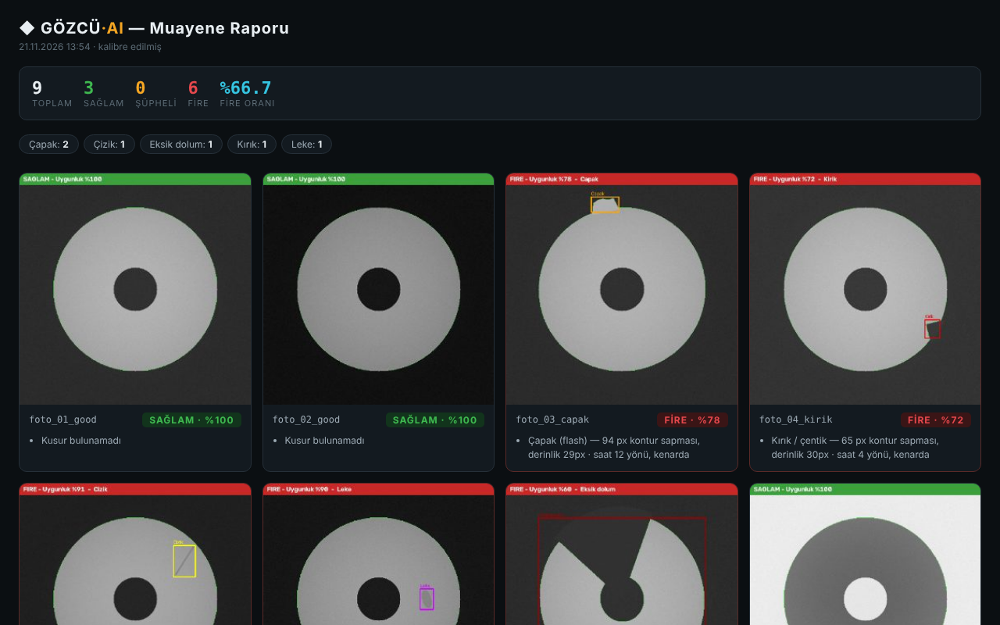
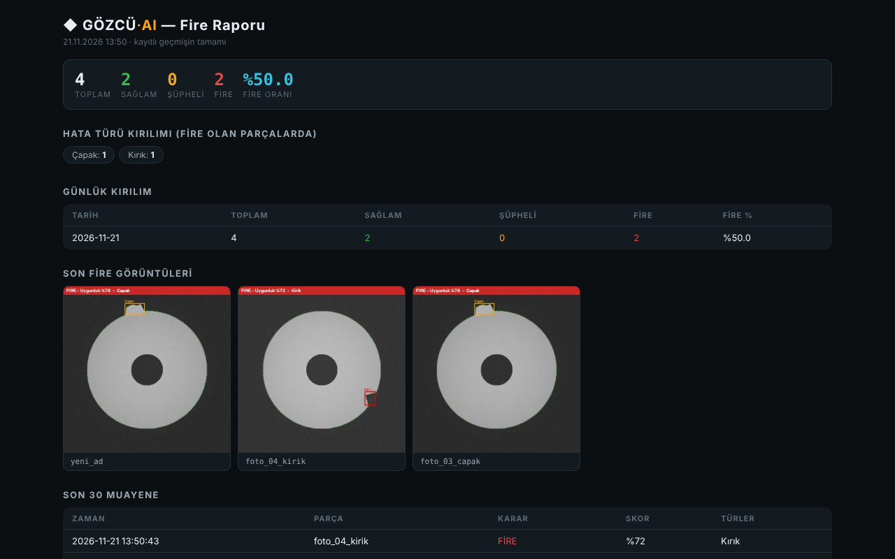

# GÖZCÜ·AI — Görüntü İşleme ile Kalite Muayenesi

**Emin değilse tahmin etmez — insana sorar.**

GÖZCÜ·AI, enjeksiyon parçalarının fotoğrafını ya da kamera görüntüsünü inceler;
her parçaya **SAĞLAM / ŞÜPHELİ / FİRE** kararı ve **%0–100 uygunluk skoru** verir,
kusuru türüyle ve yeriyle adlandırır ("Çapak · saat 12 yönü, kenarda"), görüntüye
işaretler, kalıcı fire sayaçları tutar ve paylaşılabilir raporlar üretir.
[USTA·AI](../usta-ai)'nin kardeşidir: USTA makinenin **aklı**, GÖZCÜ **gözü**.



## Neler yapar

- **Kusur türleri:** çapak, kırık/çentik, çizik, leke (renkli leke dahil),
  eksik dolum, delik (kapalı, kaçık, ölçü dışı).
- **Üçlü karar:** bulanık, karanlık, parlamalı, kadrajda kesik, çok yatık açılı
  ya da birden çok nesne içeren görüntüye karar **uydurmaz**; nedenini ve ne
  yapılacağını söyleyerek ŞÜPHELİ der.
- **Altın numuneden kalibrasyon:** geometriyi ve eşikleri *senin* sağlam
  parçandan öğrenir, sonra kendini sınar (öz-test). Öz-testi geçmeyen
  kalibrasyonla hiçbir parçaya SAĞLAM onayı vermez.
- **Zemine ve ışığa dayanıklı:** parçayı beş farklı yöntemle arar (ahşap masa,
  gün içi ışık kayması, gri tonda zemine benzeyen renkli parça dahil);
  hafif eğik çekimi kendisi düzeltir.
- **Kusur politikaları:** "küçük çizikleri önemseme" gibi fabrikaya özel
  toleranslar; tolere edilen kusur kaybolmaz, raporda gri görünür.
- **Raporlar:** tek dosyalık HTML muayene raporu, günlük kırılımlı fire raporu,
  Excel'de açılan CSV. Aynı fotoğrafı tekrar incelemek sayaçları **şişirmez**.
- **Kamera:** bilgisayar kamerası / USB kamera ile canlı muayene; otomatik
  modda parça konup durulunca kendiliğinden inceler.

## Hızlı başlangıç (Windows)

1. [python.org/downloads](https://www.python.org/downloads/) adresinden Python 3.9+
   kurun — ilk ekranda **"Add Python to PATH"** kutusunu işaretleyin.
2. Depoyu indirin (**Code → Download ZIP**) ve bir klasöre çıkarın.
3. **`1_KURULUM.bat`** — proje içine ayrı bir ortam kurar, OpenCV ve NumPy'yi yükler
   (bir kez, internet gerekir).
4. **`0_ORNEK_DENE.bat`** — hazır örnek fotoğraflarla tüm akışı dener; senin
   klasörlerine dokunmaz. Rapor tarayıcıda açılır.

### Kendi parçanla

| Adım | Ne yap | Dosya |
|---|---|---|
| 1 | Kendi **sağlam** parçanın 2–3 fotoğrafını `altin_numune/` klasörüne koy | — |
| 2 | Kalibre et; **"Öz-test: … SAĞLAM çıktı"** yazısını görmeden devam etme | `3_KALIBRE.bat` |
| 3 | Kontrol edilecek fotoğrafları `fotograflar/` klasörüne at | — |
| 4 | İncele; rapor kendiliğinden açılır | `4_FOTO_INCELE.bat` |
| 5 | Birikmiş fire raporu (HTML + Excel) | `5_FIRE_RAPORU.bat` |

Diğerleri: `2_DEMO.bat` (motorun sentetik kanıtı, 20/20), `6_SIMULASYON.bat`
(sanal bant, sayaçlara dokunmaz), `7_KAMERA_OTOMATIK.bat` (canlı kamera),
`KONTROL.bat` (kurulum tanılaması — sorun yaşarsan önce bunu çalıştır).

### macOS / Linux / Raspberry Pi
```bash
python3 -m venv .venv && .venv/bin/pip install -r requirements.txt
./baslat.sh ornek          # ya da: .venv/bin/python -m gozcu ornek
./baslat.sh kalibre
./baslat.sh incele
```
Raspberry Pi'de pip yerine sistem paketi daha sağlıklıdır:
`sudo apt install python3-opencv python3-numpy && python3 -m gozcu kontrol`

## Doğru fotoğraf — sonucun yarısı budur

1. **Parça elde değil, zeminde.** Parmak değen kenar ölçülemez.
2. **Tam tepeden, dik.** Hafif eğimi sistem düzeltir; çok yatık açıda "kamerayı dik tut" der.
3. **Kontrastlı, sade zemin.** Açık parçaya koyu, koyu parçaya açık zemin.
4. **Flaşsız, eşit ışık.** Parlama sahte kusur üretir; sistem fark ederse ŞÜPHELİ der.
5. **Altın numune ve kontrol fotoğrafları aynı düzende** çekilmeli.
6. **Yarı saydam parçanın altına** mat, zıt renkli bir karton koy.
7. `altin_numune/` klasörüne **farklı parçaları karıştırma** — sistem fark eder
   ve kalibrasyonu reddeder ("altın numuneler birbirine benzemiyor").

## Kusur politikaları ve uygunluk eşiği

```bash
python -m gozcu politika                  # mevcut ayarlar
python -m gozcu politika cizik yok_say    # çizikler karara girmez (raporda gri görünür)
python -m gozcu politika cizik hafif      # yalnız hafif çizikleri tolere et
python -m gozcu politika capak 40         # ince ayar (0–100)
python -m gozcu politika esik 95          # uygunluk %95'in altındaysa FİRE
```



## USTA·AI ile bağlantı

USTA'nın `veri/ayarlar.json` dosyasında GÖZCÜ'nün çalışma klasörünü gösterin:
`"gozcu": {"klasor": "C:\\...\\gozcu-ai"}`. GÖZCÜ'nün `sayaclar.json` ve
`gecmis.jsonl` dosyaları USTA'nın PANO'suna ve yapay zekâ bağlamına akar.

## Çalışma klasörü

```
altin_numune/   senin sağlam parça fotoğrafların   (depoya girmez)
fotograflar/    kontrol edilecek fotoğraflar        (depoya girmez)
cikti/          işaretli görüntüler + raporlar      (depoya girmez)
ayarlar.json    kalibrasyon + politikalar
sayaclar.json   kalıcı sayaçlar (+ sayılmış fotoğrafların içerik imzaları)
gecmis.jsonl    her muayenenin arşivi
```
Başka bir yer için `python -m gozcu --klasor <yol> <komut>`.

## Proje yapısı

```
gozcu/
  cli.py            komutlar (python -m gozcu …)
  calisma.py        çalışma klasörü, kalıcı sayaçlar, tekrar-sayma koruması
  segmentation.py   beş stratejili parça bulma + eğim düzeltme
  detectors.py      kontur / yüzey / renk / dolum / delik dedektörleri
  pipeline.py       kalite kapıları, üçlü karar, skor, politikalar, işaretleme
  calibrate.py      altın numuneden öğrenme + tutarlılık denetimi + öz-test
  live.py           kamera otomatik tetikleyicisi
  report_html.py, fire_report.py   raporlar
  synth.py          sentetik kusurlu parça üreteci (demo/test)
  ornekler/         örnek altın numune ve kontrol fotoğrafları
tests/              otomatik testler (38)
docs/               belgeler
```

## Geliştirme

```bash
pip install -r requirements-dev.txt
python -m pytest
```
GitHub'a her yüklemede testler Windows, macOS ve Linux'ta, Python 3.9/3.11/3.13
ile otomatik koşar (`.github/workflows/test.yml`).

## Sorun giderme

| Belirti | Çözüm |
|---|---|
| "Gerekli kütüphane eksik" | `1_KURULUM.bat` çalıştır |
| Fotoğraf "okunamadı" | OneDrive klasöründeyse: sağ tık → "Her zaman bu cihazda tut" |
| Her şey ŞÜPHELİ | Kurulum sorunu: ışık/odak/kadraj/zemin; `3_KALIBRE.bat` ile yeniden kalibre et |
| Kalibrasyon "birbirine benzemiyor" | `altin_numune/` içinde yalnız aynı tip sağlam parça bırak |
| Kamera açılmıyor | Kamerayı kullanan programı (Zoom, Teams) kapat; `python -m gozcu canli 1` dene |
| Kamera penceresi açılmıyor | `pip uninstall opencv-python-headless` sonra `pip install opencv-python` |

## Dürüst kapsam

Motor klasik görüntü işlemeyle çalışır ve **dairesel parçalar** (kapak, pul,
dişli gövdesi, konnektör tabanı) için tasarlanmıştır. Serbest biçimli parçalar ve
çok ince dokusal kusurlar için derin öğrenme tabanlı bir anomali modeli gerekir;
dedektör arayüzü buna hazırdır. Gerçek hatta en büyük üç düşman ışık değişimi,
parlama ve parça konumudur — sabit kamera ve eşit aydınlatma ile çözülür.

## Lisans

Ticari yazılım — bkz. [LICENSE](LICENSE). Satmayı planlıyorsanız GitHub deponuzu
**Private** yapın.
