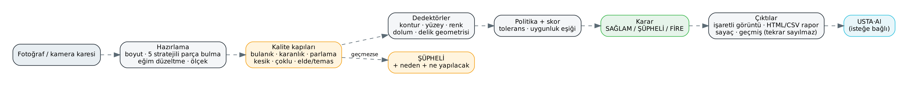
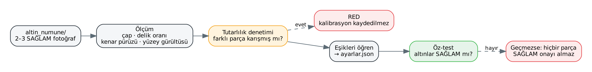

# GÖZCÜ·AI — Teknik Detay Raporu

Görüntü işleme hattı, karar mantığı, kalibrasyon, kalıcılık ve test kapsamı.

> **Hedef kitle:** teknik değerlendirme yapacak mühendis ya da karar verici.

## 1 · İşlem hattı

Her görüntü şu sırayla işlenir:

1. **Hazırlama** — çok büyük görüntü 1600 piksele indirilir; parça bulunur; hafif eğik çekim düzeltilir; parça referans ölçeğe getirilir (çekim mesafesinden bağımsızlık).
2. **Kalite kapıları** — karar verilemeyecek görüntü ayıklanır.
3. **Dedektörler** — kontur, yüzey, renk, dolum ve delik geometrisi.
4. **Tekilleştirme** — aynı olgunun çift sayılması önlenir (ör. eksik dolumda kontur bulguları bastırılır).
5. **Politika ve skor** — fabrikaya özel toleranslar ve %0–100 uygunluk.
6. **Karar** — SAĞLAM / ŞÜPHELİ / FİRE.

## 2 · Parçayı bulma: beş strateji

Tek bir eşikleme yöntemi dokulu zeminde, ışık kaymasında ve zemine benzeyen parçada kırılır. GÖZCÜ adayları beş bağımsız yöntemle üretir ve **kademeli** çalıştırır (ucuzdan pahalıya; iyi aday bulununca durur):

| Strateji | Güçlü olduğu durum |
|---|---|
| Işık düzeltmeli global eşik | Temiz sahne (üretim hattının normali) |
| Renk uzayı ayrımı (Lab, zemin rengi kenardan öğrenilir) | Gri tonda zemine benzeyen ama rengi farklı parça |
| Yerel uyarlamalı eşik | Gölge, düzensiz aydınlatma |
| Kenar tabanlı | Parlaklıktan bağımsız sınır |
| Hough daire + yerel arıtma | Ahşap gibi dokulu zemin |

Her aday **dairesellik, doluluk, sınır kontrastı ve kenara değmeme** ile puanlanır. "Parça en dıştaki makul nesnedir" kuralı, deliğin ya da yüzey deseninin parça sanılmasını önler. Hiçbir aday yeterli değilse karar verilmez.

Merkez ve yarıçap, **Kåsa cebirsel çember uydurması** ile medyana demirli yinelemeli aykırı dışlamayla bulunur: çapak lobu ya da büyük bir eksik dilim ölçümü kaydırmaz. Hafif eğim elips uydurmasıyla ölçülüp görüntü dikleştirilir; eksen oranı %80'in altındaysa (çok yatık) karar verilmez.

## 3 · Kalite kapıları

| Kapı | Ölçüt |
|---|---|
| Parça yok / çok küçük | Malzeme alanı beklenenin %15'inin altında |
| Kadrajda kesik | Parça görüntü kenarına değiyor |
| Birden çok nesne | Kazananla örtüşmeyen ikinci bir **parça-benzeri** aday (el, gölge, desen sayılmaz) |
| Karanlık / aşırı pozlama | Parça ortalama parlaklığı |
| Parlama | Patlamış piksel oranı |
| Bulanıklık | Laplace varyansı, **çekim ölçeğinde** ölçülür |
| Ölçülemeyen kenar | Kenarın %35'inden fazlasında iç/dış kontrast yok (parmak, gölge, temas) |
| Çok yatık açı | Elips eksen oranı < 0,80 |

Kapıya takılan görüntü **ŞÜPHELİ** olur ve neden + çözüm yazılır.

## 4 · Dedektörler

| Kusur | Yöntem |
|---|---|
| Çapak | Kontur yarıçapının beklenen daireden dışa sapma koşuları; derinlik ve uzunluk eşiği |
| Kırık / çentik | İçe sapma koşuları; kontur uzunluğunun %20'sinden büyük çöküntü eksik dolum sayılır |
| Çizik | Yüzeyin medyan tabanından parlaklık sapması; ince-uzun bileşen |
| Leke | Kompakt sapma bileşeni; **Lab kroma kanalı** sayesinde eş parlaklıkta renkli leke de |
| Eksik dolum | Malzeme alanının beklenen alana oranı |
| Delik | Merkez kapalı mı; açıksa merkezden kaçıklık ve ölçü dışılık |

Ölçülemeyen kenar yayları (temas, gölge) kontur analizine katılmaz. Her bulgunun konumu operatör diliyle verilir: "saat 4 yönü, kenarda".

## 5 · Karar, skor ve politika

- Her kusur türünün bir **politika** değeri vardır (0 = sıfır tolerans, 100 = yok say). Şiddeti politikanın altında kalan bulgu **tolere edilir**: karara ve skora girmez ama raporda gri olarak görünür.
- **Uygunluk skoru** %100'den başlar; her aktif bulgu türüne göre ağırlıklı ve şiddetle ölçeklenmiş ceza düşer (eksik dolum en ağır, çizik en hafif).
- **FİRE:** net (güçlü) bir bulgu varsa ya da skor uygunluk eşiğinin altındaysa. **ŞÜPHELİ:** bulgular yalnız eşik sınırındaysa ya da ölçümler eşiğe tehlikeli yakınsa. **SAĞLAM:** hiçbiri yoksa **ve** kalibrasyonun öz-testi geçmişse.

## 6 · Kalibrasyon

- Altın numunelerden çap (medyan), delik/çap **oranı** (çekim mesafesinden bağımsız), kenar pürüzlülüğü, yüzey ve renk gürültüsü ölçülür; eşikler bunlardan türetilir.
- **Tutarlılık denetimi:** numunelerin bir kısmı delikli bir kısmı deliksizse ya da delik oranları belirgin farklıysa kalibrasyon **reddedilir ve kaydedilmez** (farklı parçalar karışmıştır).
- Parça bulunamayan numune sessizce atlanmaz; adıyla bildirilir.
- **Öz-test:** altın numuneler yeni kalibrasyonla incelenir; biri bile SAĞLAM çıkmazsa sistem hiçbir parçaya SAĞLAM onayı vermez.

## 7 · Kalıcılık ve dosyalar

| Dosya | İçerik | Yazım |
|---|---|---|
| `ayarlar.json` | Kalibrasyon, politikalar, eşik | Geçici dosya + atomik yer değiştirme |
| `sayaclar.json` | Toplam, sağlam, şüpheli, fire, tür kırılımı, sayılmış fotoğrafların **içerik imzaları** | Atomik; bozuksa yedeklenip sıfırdan başlanır |
| `gecmis.jsonl` | Satır başına bir muayene | Ekleme; bozuk satır raporu düşürmez |

Bozuk ya da eski biçimli `ayarlar.json` güvenle okunur: bilinmeyen alanlar yok sayılır, geçersiz değerlerde varsayılana dönülür.

## 8 · Platform ayrıntıları

- **Türkçe karakterli yollar:** OpenCV'nin dosya okuma/yazması Windows'ta "Masaüstü" gibi yollarda başarısız olur; tüm görüntü giriş-çıkışı Python dosya API'si + bellekten kod çözme ile yapılır.
- **Görüntü üstü metin:** OpenCV'nin yerleşik yazı tipi yalnız ASCII çizer; görüntüdeki metin Türkçe→ASCII çevrilir (FİRE → FIRE), raporlar Türkçe kalır. Uzun metin bant genişliğine göre küçültülür.
- **Windows kamerası:** DirectShow, Media Foundation ve varsayılan arka uç sırayla denenir.
- **Paket yüklemesi:** `import gozcu` OpenCV'yi yüklemez; eksik kurulumda `python -m gozcu` anlaşılır bir mesaj verir.

## 9 · Test kapsamı

`python -m pytest` ile **38 otomatik test**:

| Alan | Örnekler |
|---|---|
| Doğruluk | 20 sentetik parçada karar 20/20, tür 14/14, sahte tür tespiti 0; ölçek (0,6×–1,6×) ve açık zemin |
| Zorlu sahne | Ahşap zemin, soldan sağa ışık kayması, gri-benzer/renk-farklı zemin |
| Kalibrasyon | Ahşapta kalibrasyon + kırık ve çizik tespiti; %15 eğik çekim düzeltme; %40 eğimde ŞÜPHELİ |
| Kalite kapıları | Bulanık, karanlık, kesik, çoklu nesne, boş sahne, sınırda bulgu |
| Ek dedektörler | Eş parlaklıkta renkli leke, kaçık delik + saat yönü |
| Politika | Tolere etme ve raporlama, %95 eşik |
| Akış | Türkçe yol, örneklerin kullanıcı klasörüne dokunmaması, **tekrar sayılmama** (yeniden adlandırılmış kopya dahil), sıfırlama, karışık altın numunenin reddi, bozuk dosyalar, kontrol komutu, simülasyonun sayaçlara dokunmaması, otomatik kamera tetiği |

GitHub Actions her yüklemede Windows, macOS, Linux × Python 3.9/3.11/3.13 ile testleri ve demoyu koşar. Ayrıca Python 3.9 + OpenCV 4.14 ve Python 3.13 + OpenCV 5.0 ile elle doğrulanmıştır.

## 10 · Bilinen sınırlar

- Dairesel parçalar için tasarlanmıştır; serbest biçimli parçalar desteklenmez.
- Çok ince dokusal kusurlar (mikro çatlak, matlık farkı) klasik yöntemlerin sınırındadır.
- Hat üstü tetikleme şu an görüntü farkıyla yapılır; PLC/sensör tetiği yol haritasındadır.
