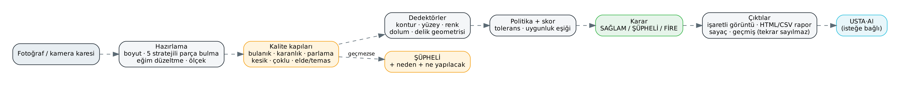

# GÖZCÜ·AI — Mimari ve Yol Haritası

## 1 · Sorun

- Görsel kalite kontrol göze dayanır; yorgunluk, vardiya ve kişi değiştikçe karar değişir.
- Fire sayısı tutulsa bile **hangi kusurun neden arttığı** kayda geçmez; makine ayarıyla bağlantı kurulamaz.
- Hazır makine görüş sistemleri küçük işletme için pahalı ve kurulumu uzmanlık ister.

## 2 · Çözüm

Bir kamera ve bilgisayarla çalışan, **kendi sağlam parçanızdan öğrenen**, kararını gerekçesiyle veren ve emin olmadığında tahmin etmeyen bir kalite gözü. Fire verisi türüyle birikir ve USTA·AI'ye akarak makine ayarı önerisine dönüşür.

## 3 · Tasarım ilkeleri

1. **Emin değilse tahmin etme.** Kötü görüntüde ŞÜPHELİ de; nedenini ve çözümünü yaz.
2. **Kaçak, yanlış redden daha kötüdür.** Öz-testi geçmeyen kalibrasyonla SAĞLAM onayı verilmez.
3. **Şeffaflık.** Tolere edilen kusur kaybolmaz; raporda görünür.
4. **Kurulum kullanıcıyı korur.** Karışık altın numune reddedilir; aynı fotoğraf iki kez sayılmaz; örnekler kullanıcının klasörüne karışmaz.
5. **Açıklanabilirlik.** Her bulgu ölçüm ve konumla gelir.

## 4 · Mimari

Ayrıntı: [03_Teknik_Detay_Raporu](03_Teknik_Detay_Raporu.md).

## 5 · Bugün nerede? (v2.0)

| Yetenek | Durum |
|---|---|
| Fotoğraf klasörüyle muayene, HTML/CSV raporlar | Tamam |
| Altın numune kalibrasyonu, tutarlılık denetimi, öz-test | Tamam |
| Beş stratejili parça bulma, eğim düzeltme, kalite kapıları | Tamam |
| Kusur politikaları, uygunluk skoru ve eşiği | Tamam |
| Kalıcı sayaçlar, tekrar sayma koruması, fire raporu | Tamam |
| Canlı kamera, otomatik tetik | Kod ve tetik mantığı test edildi; farklı kameralarla sahada denenmeli |
| USTA·AI köprüsü | Tamam (dosya tabanlı) |
| Gerçek üretim hattı | Henüz denenmedi |

## 6 · Yol haritası

| Aşama | İçerik | Çıkış ölçütü |
|---|---|---|
| 1 · Masa pilotu | Bir ürün, sabit kamera + ışık, operatörün fotoğrafla/kamerayla kontrolü | 200 parçada insan kararıyla uyum; ŞÜPHELİ oranı < %5 |
| 2 · Eşik ayarı | Ceza ağırlıkları ve politikalar sahadaki gerçek kusurlarla | Kalite biriminin onayı |
| 3 · Hat üstü | Endüstriyel kamera, kubbe ışık, sensör/PLC tetiği | Çevrim süresi içinde karar |
| 4 · Ayırma | Ret sinyali ile pnömatik ayırıcı (PLC üzerinden, emniyet değerlendirmesiyle) | Otomatik ayırma |
| 5 · Öğrenen model | İnsan onaylı ŞÜPHELİ kararlarından veri seti; derin öğrenme anomali dedektörü | Serbest biçimli parçalar |
| 6 · USTA kapalı döngü | Fire türü artışında makine ayarı önerisi | Fire oranında ölçülebilir düşüş |

## 7 · Riskler

| Risk | Önlem |
|---|---|
| Işık değişimi | Kapalı ışık muhafazası; çok stratejili bulma; kalite kapıları |
| Yanlış kalibrasyon | Tutarlılık denetimi + bağlayıcı öz-test |
| Kaçak (kusurlu parçanın geçmesi) | Üçlü karar, sınırda bulgu = ŞÜPHELİ, uygunluk eşiği |
| Fazla red | Politikalar; ŞÜPHELİ'lerin insan kontrolüne gitmesi |
| Serbest biçimli parça talebi | Yol haritası aşama 5 |
